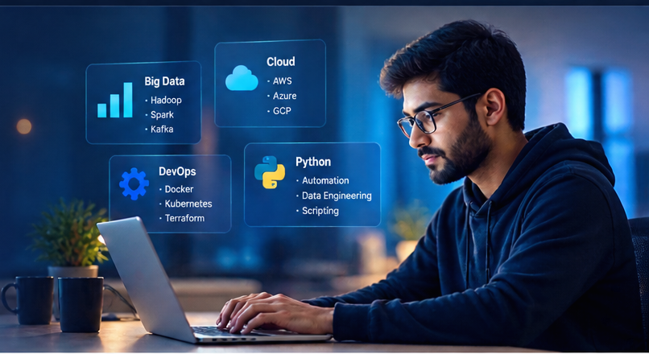

---
hide:
  - toc
  - path
---

  

    

      ABHIMANYU'S TECH ACADEMY
    

    <h1>
      Master Real-World 
      Technology Skills
    </h1>

    

      Learn the technologies used in real production environments —
      from Big Data and Cloud to DevOps, Python and automation.
    

    

      <a href="00-learning-roadmap/" class="academy-button">
        📖 Explore Learning →
      </a>

      <a href="14-production-troubleshooting/" class="academy-button academy-button-outline">
        🧪 Explore Production Labs →
      </a>
    

    

      🐘 Hadoop
      ⚡ Spark
      ☁️ Cloud
      ♾️ DevOps
      🐍 Python
      ☸️ Kubernetes
      🔧 Terraform
    

  

  

    

    

    

      <strong>📊 Big Data</strong>
      <small>Hadoop · Spark · Kafka</small>
    

    

      <strong>☁️ Cloud</strong>
      <small>AWS · Azure · GCP</small>
    

    

      <strong>⚙️ DevOps</strong>
      <small>Docker · Kubernetes · Terraform</small>
    

    

      <strong>🐍 Python</strong>
      <small>Automation · Data Engineering</small>
    

  

<section class="academy-section">

  

    <h2>Explore Learning</h2>
    

      Build practical skills across the technologies used by modern
      data and infrastructure teams.
    

  

  

    <a href="01-hdfs/" class="academy-course-card">
      
🐘

      <h3>Big Data</h3>
      

        Master the Hadoop ecosystem from architecture
        to production operations.
      

      Explore Big Data →
    </a>

    <a href="00-learning-roadmap/" class="academy-course-card">
      
☁️

      <h3>Cloud Engineering</h3>
      

        Learn modern cloud infrastructure, networking,
        security and architecture.
      

      Explore Cloud →
    </a>

    <a href="00-learning-roadmap/" class="academy-course-card">
      
⚙️

      <h3>DevOps</h3>
      

        Learn automation, containers, CI/CD and
        production engineering practices.
      

      Explore DevOps →
    </a>

    <a href="00-learning-roadmap/" class="academy-course-card">
      
🐍

      <h3>Python & Data Engineering</h3>
      

        Automate operations, process data and build
        modern engineering workflows.
      

      Explore Python →
    </a>

    <a href="00-learning-roadmap/" class="academy-course-card">
      
📊

      <h3>Monitoring & Observability</h3>
      

        Learn monitoring, alerting, capacity planning
        and production visibility.
      

      Explore Monitoring →
    </a>

    <a href="14-production-troubleshooting/" class="academy-course-card">
      
🧪

      <h3>Hands-on Labs</h3>
      

        Practice realistic infrastructure and
        production troubleshooting scenarios.
      

      Explore Labs →
    </a>

  

</section>

<section class="academy-process">

  

    <h2>Learn. Practice. Troubleshoot. Operate.</h2>
    

      Go beyond theory with a practical, production-focused approach.
    

  

  

    

      <strong>01</strong>
      <h3>Understand</h3>
      
Learn architecture and core concepts.

    

    
→

    

      <strong>02</strong>
      <h3>Practice</h3>
      
Work with real examples and hands-on labs.

    

    
→

    

      <strong>03</strong>
      <h3>Troubleshoot</h3>
      
Solve realistic production problems.

    

    
→

    

      <strong>04</strong>
      <h3>Operate</h3>
      
Build confidence to work in production.

    

  

</section>

<section class="academy-final-cta">

  

    <h2>Your journey starts here.</h2>

    

      Learn the technology. Build the system.
      Break it safely. Understand why it failed.
      Then learn how to operate it.
    

  

  

    <a href="00-learning-roadmap/" class="academy-button">
      📖 Start Learning →
    </a>

    <a href="01-hdfs/" class="academy-button academy-button-outline">
      🐘 Start with HDFS →
    </a>

  

</section>
